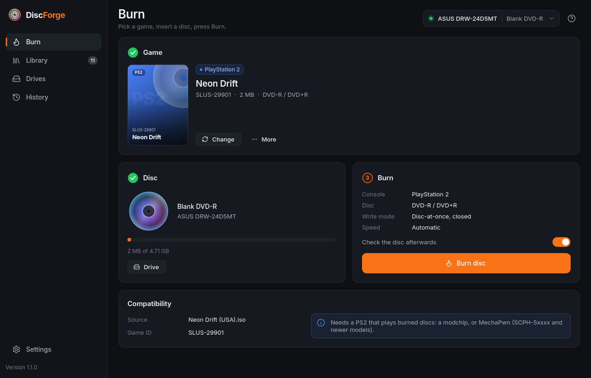
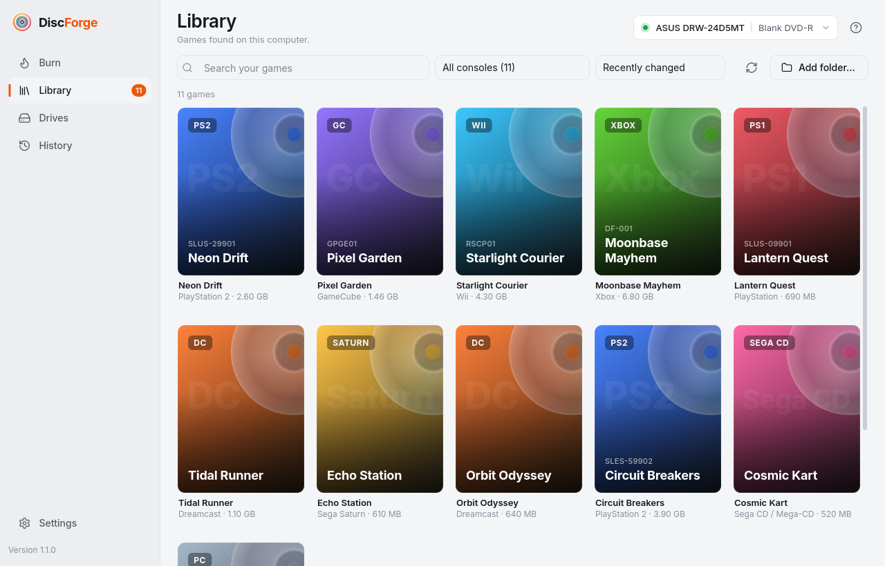
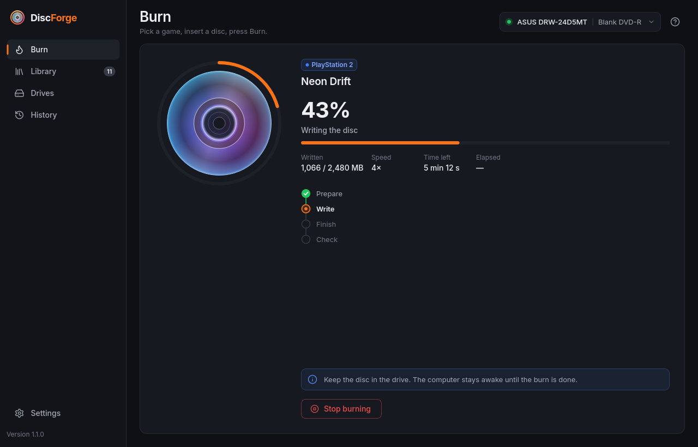
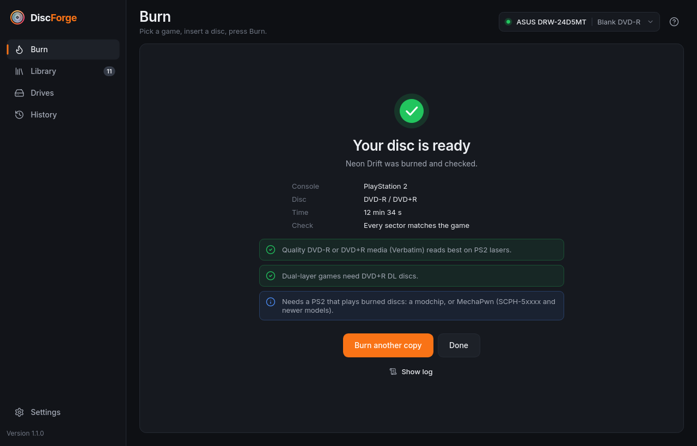
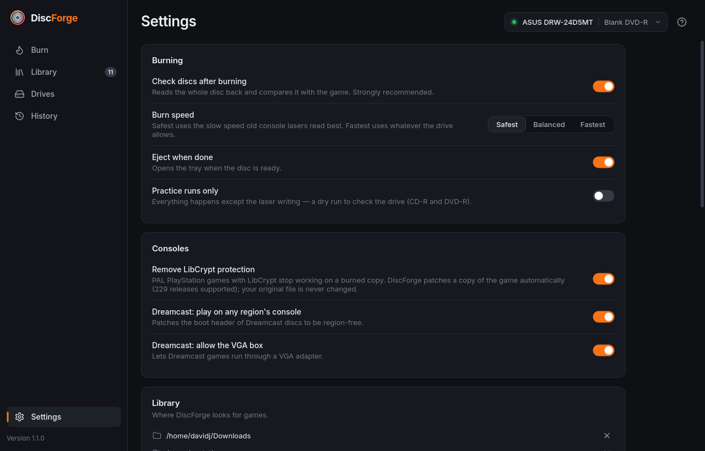

<p align="center">
  
</p>

<h1 align="center">DiscForge</h1>

<p align="center">
  
  
  
  <a href="https://github.com/DJagerStudios/DiscForge/actions/workflows/ci.yml"></a>
</p>

<p align="center">
  <b>Burn retro console games, homebrew and software to CD and DVD, exactly the way the console needs them.</b><br>
  Pick a game, put in a blank disc, press Burn. DiscForge works out what the game is, which disc it needs,<br>
  how that console reads discs, and burns and checks it with the right settings.
</p>

<p align="center">
  <a href="https://github.com/DJagerStudios/DiscForge/releases/latest"><b>Download the latest release</b></a>
  &nbsp;&middot;&nbsp; Windows, macOS, Linux and FreeBSD
</p>

<br>

<p align="center">
  
</p>

## Download

Get the file for your system from the [latest release](https://github.com/DJagerStudios/DiscForge/releases/latest). Everything DiscForge needs, including the burning tools, is inside: there is nothing else to install.

| System | Download | Notes |
|---|---|---|
| **Windows 10 / 11** (x64) | `DiscForge-<version>-windows-x86_64.zip` | Unzip anywhere and run `DiscForge.exe`. No administrator rights needed. |
| **macOS 14 or later** (Apple Silicon, Intel) | `DiscForge-<version>-macos-aarch64.zip` / `-x86_64.zip` | Drag `DiscForge.app` to Applications. |
| **Linux** (x86_64) | `DiscForge-<version>-linux-x86_64.AppImage` or `.tar.gz` | Ubuntu 22.04+, Debian 12+, Fedora 36+, Arch, openSUSE Tumbleweed, Mint 21+ and others (glibc 2.35+). |
| **Linux** (aarch64, Raspberry Pi 4/5) | `DiscForge-<version>-linux-aarch64.AppImage` or `.tar.gz` | Ubuntu 24.04+, Debian 13, Raspberry Pi OS Trixie (glibc 2.39+). |
| **FreeBSD 14+** | `DiscForge-<version>-freebsd-x86_64.tar.gz` | Unpack and run `./install.sh` as root; it installs what it needs with `pkg`. |
| **Anything else** (OpenBSD, older Linux…) | the source | Python 3.10+ with PySide6: `pip install .` then `discforge-gui`. |

`DiscForge-<version>-SHA256SUMS` lists the checksums of every file. The builds aren't signed by Apple or Microsoft. On macOS, the first time, right-click the app and choose **Open**, or go to System Settings › Privacy & Security › **Open Anyway** (or run `xattr -dr com.apple.quarantine /Applications/DiscForge.app`). On Windows, choose **More info › Run anyway** in the SmartScreen prompt. The Linux `.tar.gz` has an `install.sh` that adds DiscForge to your applications menu.

## What it burns

| System | Disc | How it's written | Files it opens |
|---|---|---|---|
| **Dreamcast** | CD-R | MIL-CD selfboot: an audio session and an XA data session at LBA 11702, with a checked or rebuilt boot header | `.cdi` `.gdi` `.chd` `.iso`, homebrew `.elf`/`.bin`/folders |
| **PlayStation** | CD-R | raw disc-at-once: every 2352-byte sector, the audio tracks and the gaps exactly as the image has them | `.cue`+`.bin` (one or many), `.chd`, `.ecm`, `.ccd`+`.img`, `.iso` |
| **PlayStation 2** | DVD-R, DVD+R, DVD+R DL | closed disc; DVD-ROM book type on DVD+R; the game's own layer break on dual-layer games | `.iso`, `.cso`/`.zso`, `.chd`; CD games as `.cue`/`.bin` |
| **GameCube** | DVD-R (mini DVD-R fits) | closed disc | `.iso`/`.gcm`, `.rvz`, `.gcz` |
| **Wii** | DVD-R, DVD+R DL | closed disc, layer break at the Wii's position | `.iso`, `.wbfs` (+ splits), `.rvz`/`.wia`, `.gcz` |
| **Xbox** | DVD-R, DVD+R | Redump images and folders rebuilt as XISO, with the media check patched so the game runs from a DVD-R | `.iso`, `.xiso`, folders with `default.xbe` |
| **Saturn, Sega CD, PC Engine CD, PC-FX, Neo Geo CD, Amiga CD32, CD-i, 3DO** | CD-R | raw disc-at-once | `.cue`+`.bin`, `.chd`, `.ccd` |
| **PC / data** | CD-R or DVD | as is; a folder becomes a data disc | `.iso`, any folder |

Zip, 7z and RAR archives are unpacked automatically. DiscForge only burns what's in your image: most consoles need a modchip or a softmod to play burned discs, and each game shows what its console needs. The Dreamcast boots selfboot CD-Rs on most consoles, and the Sega CD, PC Engine CD, PC-FX, Neo Geo CD, CD32 and 3DO read burned discs as they are.

<p align="center">
  
  
</p>

## Exactly right, every time

A disc that's almost right doesn't boot. These are the details DiscForge takes care of:

- **Every sector as it is.** CD games are written raw, disc-at-once: Mode 2 Form 2 video, subheaders and error-correction bytes go to the disc exactly as they are in the image, with the image's track layout, pregaps, postgaps and indexes. Drives that can't write raw fall back to standard mode, except for games that only work raw.
- **The audio the right way round.** Raw audio in `.bin` rips is byte-swapped for the burner, while WAVE and big-endian audio files are handled on their own terms, so music tracks don't come out as noise.
- **LibCrypt removed.** Many PAL PlayStation games stop working partway through on a copy. DiscForge recognises 229 of them and patches a copy of the game (the patches from [LibCrypt Patcher](https://github.com/alex-free/libcrypt-patcher)). It checks every patched sector's error correction before burning, and your original file is never changed.
- **Games that need special care.** EDC-protected PlayStation titles are always written raw. Games with anti-modchip protection get a warning. PS2 dual-layer games keep their layer break and need DVD+R DL. GameCube games with streamed audio get a note, and Xbox games get the media check patched.
- **Images that are almost burnable.** ECM files are decoded (and checked against their checksum), 2336-byte-sector images get their sync and headers rebuilt, CHD, WBFS, CSO, GCZ and RVZ are unpacked, and a `.bin` without its `.cue` is identified on its own. Dreamcast GD-ROM dumps are converted to selfboot CD-Rs.
- **The right disc.** DiscForge refuses a CD-RW for consoles that can't read one, a DVD-R DL for a game whose layer break needs DVD+R DL, and a disc that's too small. It warns about 80-minute CD-Rs on early PS2s.
- **Checked afterwards.** After burning, the disc's table of contents must match the plan track for track, then every data sector is read back and compared byte for byte. You're told plainly whether every sector matched or only part of the disc could be checked.

## Easy to use

- **Your drives, found for you.** Internal and USB writers are detected on every system, with what they can write and what's in them. If your user can't use the drive, DiscForge tells you the one-line fix.
- **Your games, found for you.** The library looks in your Downloads, Documents, Games and ROMs folders, and you can add your own. Drag a game onto the window, or open it from your file manager.
- **Slow and steady.** The speed old console lasers read best is chosen for you, the computer stays awake during the burn, and DiscForge offers the next disc of a multi-disc game when one is done.
- **A history of every burn**, with the full log, plus a dark and a light theme, reduced motion, and keyboard control.
- **A command line too:**

  ```sh
  discforge info "Game (USA).cue"        # what it is and how it would be burned
  discforge burn "Game (USA).iso"        # burn to the first drive (asks first; -y to skip)
  discforge burn game.wbfs --simulate    # practice run with the laser off (CD-R and DVD-R)
  discforge drives                       # writers and the disc in each
  discforge doctor                       # everything DiscForge needs, and what's missing
  ```

  On Windows and macOS the command is `discforge-cli` (inside the app folder or bundle). The Linux AppImage takes the same commands: `./DiscForge-1.1.0-linux-x86_64.AppImage doctor`.

<p align="center">
  
  
</p>

## Using your drive

- **Linux:** your user needs to be in the drive's group (`optical` or `cdrom`). DiscForge shows the exact command if it isn't, for example `sudo usermod -aG optical $USER`, then log out and back in.
- **Windows:** nothing to set up. Burning over Remote Desktop needs the `AllowRemoteDASD` policy.
- **macOS:** when macOS asks what to do with the blank disc, choose **Ignore**. DiscForge unmounts the disc itself before burning.
- **FreeBSD:** `install.sh` prints the `devfs.rules` lines that give the `operator` group the drive.

## Honest about testing

DiscForge's burning code is tested against simulated CD and DVD drives that lay discs out the way real drives do, on Linux, macOS and FreeBSD in every CI run (the rest of the tests run on Windows too), every download is started and self-tested on its own system before release, and the result of every real burn is checked by reading the disc back. Real drives vary, though, and burning on Windows and macOS is new in this release. If a burn doesn't work for you, please [open an issue](https://github.com/DJagerStudios/DiscForge/issues) with the log from History.

## Building from source

```sh
pip install -r packaging/requirements-test.txt            # PySide6, numpy, lz4
python -m discforge gui                                   # run it
python -m unittest discover -s tests                      # unit tests and simulated burns
QT_QPA_PLATFORM=offscreen python tests/gui_smoke.py       # the real window burns games on simulated drives
QT_QPA_PLATFORM=offscreen python tests/ui_check.py OUT    # every page, size and theme, checked for layout faults
python packaging/build.py --tools TOOLS                   # the standalone download for this system
```

`packaging/tools/` builds the bundled burning tools from pinned sources (Linux, macOS) or pinned official binaries (Windows). Pushing a `v*` tag runs [the release workflow](.github/workflows/release.yml), which builds every download, checks that each one starts on its own system, and publishes them. On Linux, `./install.sh` sets up a source checkout with a desktop icon, menu entry and file-manager actions.

## Licence

DiscForge is free software under the [GNU GPL, version 3 or later](LICENSE). It bundles programs that keep their own licences: cdrtools (CDDL and GPL-2.0), cdrdao (GPL-2.0+), dvd+rw-tools (GPL-2.0), 7-Zip (LGPL) and, on Windows, chdman from MAME (GPL-2.0+). Each download has them in `LICENSES` or `tools/licenses`, and every release publishes their exact source code (`DiscForge-<version>-tool-sources.tar`). Also included: the Inter typeface (SIL OFL), Lucide icons (ISC), the LibCrypt Patcher patches (BSD-3-Clause) and the KallistiOS IP.BIN template (BSD). The Dreamcast scrambling algorithm is by Marcus Comstedt.

DiscForge doesn't include any games. Burn homebrew, abandonware and games you own.
