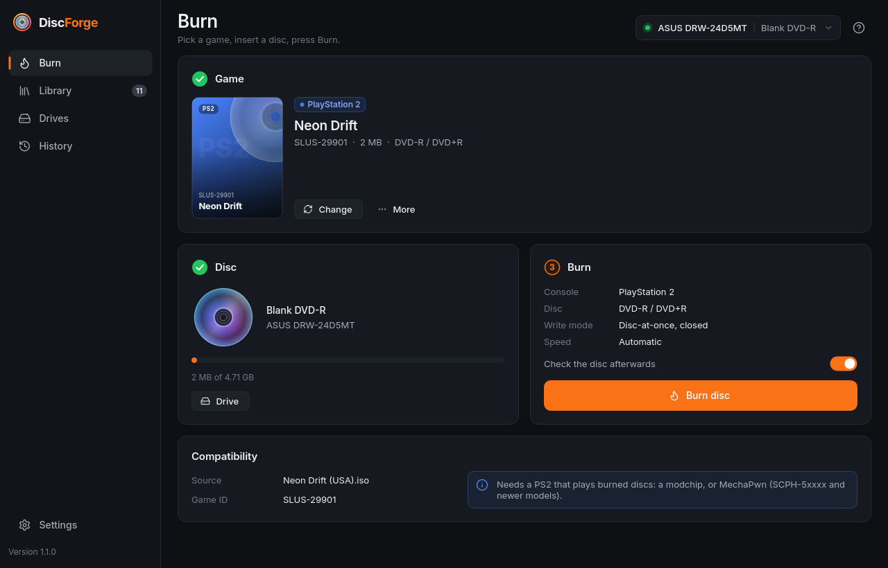
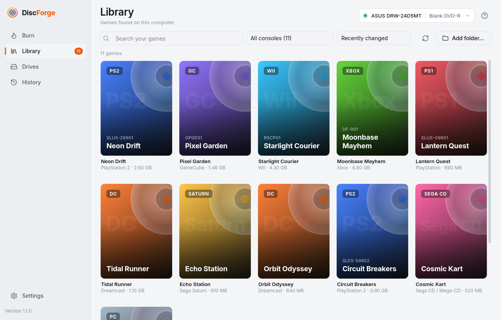

## DiscForge 1.1.0: burn it right, on every desktop

DiscForge is a free, open source disc burner for retro consoles, homebrew and software. Pick a game, put in a blank disc and press Burn: DiscForge works out what the game is, which disc it needs and how that console reads discs, then burns it with the right settings and checks every sector afterwards. This is the first public release, with standalone downloads for Windows, macOS, Linux and FreeBSD that carry their own burning tools.

## Highlights

### Every console, the way it needs it

- **Dreamcast**: selfboot CD-Rs (an audio session and an XA data session at LBA 11702), from `.cdi`, `.gdi`, `.chd`, `.iso`, homebrew programs or folders. GD-ROM dumps are converted automatically, and the boot header can be made region-free and VGA-ready.
- **PlayStation, Saturn, Sega CD, PC Engine CD, PC-FX, Neo Geo CD, Amiga CD32, CD-i and 3DO**: raw disc-at-once burns that keep every 2352-byte sector, every audio track and every gap exactly as the image has them.
- **PlayStation 2, GameCube, Wii and Xbox**: closed DVDs, the DVD-ROM book type on DVD+R, each dual-layer game's own layer break, and Xbox images rebuilt as XISO with the media check patched.
- **PC and data discs**: ISOs as they are; a folder becomes a data disc.

### The details that make a copy boot

- **LibCrypt removed automatically** from 229 PAL PlayStation releases (patches from LibCrypt Patcher), with every patched sector's error correction checked before burning. Your original file is never changed.
- **Exceptions handled**: EDC-protected PlayStation games are always written raw, anti-modchip games get a warning, PS2 layer breaks are checked, and GameCube streamed audio gets a note.
- **The right disc for the console**: CD-RW is refused for consoles that can't read it, DVD-R DL for games that need a DVD+R DL layer break, and anything too small. Early PS2s get an 80-minute CD-R warning.
- **More images just work**: ECM is decoded with no extra tools (checksum verified), 2336-byte-sector images get their sync and headers rebuilt exactly, and CHD, WBFS, CSO/ZSO, GCZ, RVZ/WIA, zip, 7z and RAR are unpacked. Older PS2 CHDs packed as hard disks are opened too.
- **Checked afterwards**: the disc's table of contents must match the plan, then every data sector is read back and compared byte for byte.

### Standalone downloads

- **Windows 10 and 11** (x64): a portable `.zip`. Unzip it and run `DiscForge.exe`; no administrator rights are needed.
- **macOS 14 or later**: `DiscForge.app` for Apple Silicon and for Intel.
- **Linux**: an `.AppImage` or a `.tar.gz` (with a menu installer) for x86_64 (glibc 2.35+: Ubuntu 22.04, Debian 12, Fedora 36 and newer) and aarch64 (glibc 2.39+: Ubuntu 24.04, Debian 13, Raspberry Pi OS Trixie).
- **FreeBSD 14**: a `.tar.gz` whose `install.sh` installs what it needs with `pkg`.
- The burning tools are inside every download: cdrtools 3.02a09, cdrdao 1.2.6, dvd+rw-tools 7.1 (Linux), 7-Zip 26.05 and, on Windows, chdman from MAME 0.289. Their exact source code is attached to this release.

### Easy to use

- **Drives and games found for you**: writers are detected on every system, with what they can write and what's in them. The library looks in your Downloads, Documents, Games and ROMs folders.
- **Help when something's missing**: a drive your user can't reach comes with the one-line fix. A missing tool installs in the background with one click (pkexec, or Homebrew on macOS), and the burn carries on.
- **Thoughtful burns**: console-friendly speeds, the computer kept awake, the next disc of a multi-disc game offered when one is done, desktop notifications, and taskbar progress.
- **Test before you burn**: Dreamcast discs open in Flycast or RetroArch, found in the usual places on every system (Flatpak included).
- **A clean, responsive interface** in dark and light, from the smallest window up. Everything works from the keyboard: Ctrl+1 to Ctrl+4 switch pages, Tab reaches every control and shows where you are, and Space and the arrow keys work toggles and choices.
- **A history of every burn** with its full log, and a command line (`discforge info`, `burn`, `drives`, `doctor`).

## Install

1. Download the file for your system below, and check it against `DiscForge-1.1.0-SHA256SUMS` if you like.
2. **Windows**: unzip and run `DiscForge.exe`. If SmartScreen appears, choose *More info* › *Run anyway*.
3. **macOS**: unzip and drag `DiscForge.app` to Applications. The first time, right-click it and choose *Open* (or System Settings › Privacy & Security › *Open Anyway*). When macOS asks what to do with a blank disc, choose *Ignore*.
4. **Linux**: make the AppImage executable (`chmod +x DiscForge-1.1.0-linux-x86_64.AppImage`) and run it, or unpack the `.tar.gz` and run `./install.sh` to add DiscForge to your menu. To use the drive, your user needs to be in its group (`optical` or `cdrom`); DiscForge shows the command if not.
5. **FreeBSD**: unpack the `.tar.gz` and run `./install.sh` as root. It prints the `devfs.rules` lines that let your user reach the drive.

## Good to know

- Most consoles only play burned discs when they're modded; each game shows what its console needs. DiscForge doesn't include any games: burn homebrew, abandonware and games you own.
- The burning code is tested against simulated drives on Linux, macOS and FreeBSD, and every download is started and self-tested on its own system before release. Burning on Windows and macOS is new; if a burn doesn't work, please open an issue with the log from History.
- The builds aren't signed by Apple or Microsoft, which is why the first-start prompts above appear.
